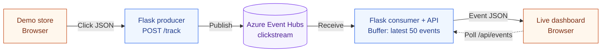
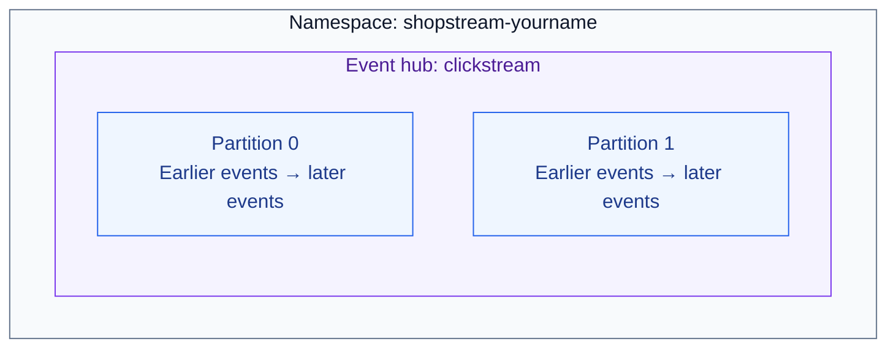
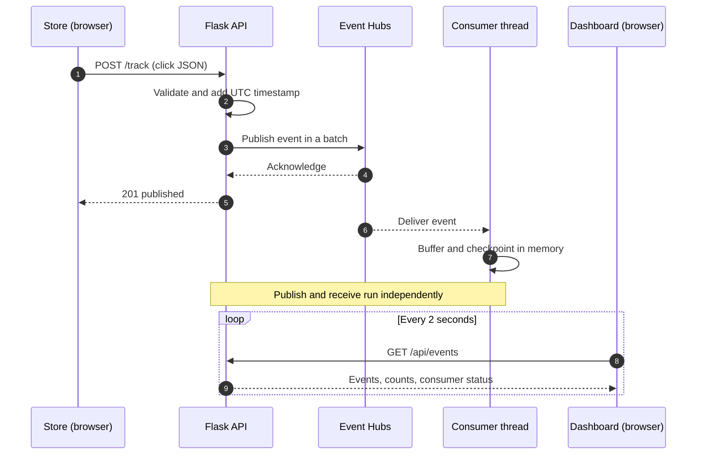

# Week 10 Lab: Clickstream Analytics with Azure Event Hubs

**CST8916 — Remote Data and Real-time Applications**

When someone browses an online store, each page view, product click, or cart action tells a small part of their story. A sequence of these actions is called a **clickstream**. Each action can be represented as an **event**: a JSON message describing what happened and when.

In this lab, you will use **Azure Event Hubs** to carry those events from a demo store to a live dashboard. Event Hubs stores a stream of events so an application can publish them now and another application can read and process them at its own pace.

You will first run the application on your computer, then deploy the same code to **Azure App Service**. No previous Event Hubs experience is required.

By the end, you should be able to:

- Identify the producer and consumer in an event streaming application.
- Explain namespaces, event hubs, partitions, and consumer groups.
- Trace a browser action through Azure to the dashboard.
- Explain how retention, checkpoints, and an in-memory buffer affect replay.

## Lab roadmap

1. [Understand the application](#1-understand-the-application)
2. [Prepare your environment](#2-prepare-your-environment)
3. [Create the Event Hubs resources](#3-create-the-event-hubs-resources)
4. [Run and explore locally](#4-run-and-explore-locally)
5. [Trace an event through the code](#5-trace-an-event-through-the-code)
6. [Deploy to Azure App Service](#6-deploy-to-azure-app-service)
7. [Verify the event stream](#7-verify-the-event-stream)
8. [Reflect on the design](#8-reflect-on-the-design)
9. [Clean up Azure resources](#9-clean-up-azure-resources)

## 1. Understand the application

**ShopStream** has two browser pages served by one Flask application:

| Page | Path | What you will see |
| --- | --- | --- |
| Demo store | `/` | Products, cart buttons, a clickable banner, and a publish log |
| Live dashboard | `/dashboard` | Recent events, counts by event type, and consumer status |

The Flask application has two Event Hubs roles. The **producer** publishes browser events through `/track`. The **consumer** runs on a background thread, reads events from Azure, and places them in a buffer. The dashboard requests that buffer through `/api/events` every two seconds.

### Application architecture



The browser communicates with Flask; the Azure connection string stays on the server. A successful publish means Azure accepted an event. The event appears on the dashboard only after the consumer receives it.

### Why introduce Event Hubs?

For a small demo, a list or database can store clicks directly. Event Hubs introduces useful capabilities as an application grows:

- **Independent processing:** Analytics, fraud detection, and other applications can read the same stream using separate consumer groups.
- **Retention and replay:** A consumer can read retained events after an interruption or process them again.
- **Parallel processing:** Partitions let applications distribute work across readers. Available namespace capacity and application design still limit throughput.

Event Hubs retains events for the configured period even after they are read. It does not calculate the dashboard's counts; our Python code does that. See [Microsoft's Event Hubs concepts](https://learn.microsoft.com/en-us/azure/event-hubs/event-hubs-features).

### Terms you will use

| Term | Meaning in this lab |
| --- | --- |
| **Namespace** | The Azure resource containing your event hub and its connection endpoint |
| **Event hub** | The named stream, `clickstream`, that stores the events |
| **Partition** | An ordered sequence within that stream; this lab uses two |
| **Producer** | The Flask code using `EventHubProducerClient` to send events |
| **Consumer** | The background thread using `EventHubConsumerClient` to read events |
| **Consumer group** | An independent view of a stream; this app uses the built-in `$Default` group |
| **Checkpoint** | A record of a consumer's progress within a partition |

## 2. Prepare your environment

You need:

- Python **3.12 recommended** (3.11 or later) and pip.
- Git, a GitHub account, and a code editor.
- An Azure subscription that allows you to create Event Hubs and Linux App Service resources.
- Access to the [Azure portal](https://portal.azure.com).

**Costs:** Event Hubs Basic is a paid tier. Use the subscription and pricing plan approved for your course, and complete the cleanup step. Azure CLI is optional; the main exercise uses the portal.

### Fork and clone once

1. Open the instructor's lab repository on GitHub and select **Fork**.
2. Clone your fork, replacing `YOUR-USERNAME` with your GitHub username:

```bash
git clone https://github.com/YOUR-USERNAME/26F_CST8916_Week10-Event-Hubs-Lab.git
cd 26F_CST8916_Week10-Event-Hubs-Lab
```

Use this same clone for the local exercise and deployment.

### Create a virtual environment

A virtual environment keeps this lab's Python packages separate from other projects.

**Linux / macOS:**

```bash
python3 -m venv .venv
source .venv/bin/activate
python -m pip install -r requirements.txt
```

**Windows PowerShell:**

```powershell
py -3 -m venv .venv
.\.venv\Scripts\Activate.ps1
python -m pip install -r requirements.txt
```

The remaining Python commands assume the virtual environment is active. If you open a new terminal, activate it again.

## 3. Create the Event Hubs resources

### 3.1 Create a resource group and namespace

1. In the Azure portal, search for **Resource groups** and select **Create**.
2. Choose your subscription, name the group `cst8916-week10-rg`, and select **Canada Central** or your instructor's region.
3. Select **Review + create**, then **Create**.
4. Search for **Event Hubs** and select **Create**.
5. Use these settings:

| Setting | Value |
| --- | --- |
| Resource group | `cst8916-week10-rg` |
| Namespace name | `shopstream-yourname` (replace `yourname`; must be globally unique) |
| Region | Same region as your resource group |
| Pricing tier | **Basic** |
| Throughput units, if shown | **1** |

6. Select **Review + create**, then **Create**. When deployment finishes, select **Go to resource**.

### 3.2 Create the event hub

Inside the namespace, select **+ Event Hub** (or **Entities → Event Hubs → + Event Hub**) and create:

| Setting | Value |
| --- | --- |
| Name | `clickstream` |
| Partition count | **2** |
| Message retention | **1 day** (24 hours) |

Your resource structure will look like this. The boxes show containment; each partition stores its own ordered sequence.



Ordering is guaranteed **within a partition**, so events read from different partitions do not form one guaranteed global order. Two partitions allow parallel reading; they do not automatically double throughput.

Basic supports one consumer group and up to one day of retention, which is sufficient for this exercise. Adding independent consumer groups requires a higher tier. See the [Event Hubs tier comparison](https://learn.microsoft.com/en-us/azure/event-hubs/compare-tiers).

### 3.3 Create a connection policy

This app both publishes and receives, so its connection string needs **Send** and **Listen** permissions.

1. Open the namespace's **Shared access policies** page.
2. Select **+ Add**, name the policy `clickstream-lab`, and select **Send** and **Listen**. Leave **Manage** unchecked.
3. Save the policy, open it, and copy the **Connection string–primary key** value. Copy the connection string, not just the key.

Keep this value private. Store it in environment variables, and exclude it from commits, screenshots, and submitted work. The lab policy gives the app the permissions it needs without using the namespace's administrative `RootManageSharedAccessKey`. See [Microsoft's shared access policy guidance](https://learn.microsoft.com/en-us/azure/event-hubs/authorize-access-shared-access-signature).

## 4. Run and explore locally

### 4.1 Set the environment variables

In your activated terminal, replace the placeholder with the **entire connection string** copied from Azure.

**Linux / macOS:**

```bash
export EVENT_HUB_CONNECTION_STR='PASTE-YOUR-CONNECTION-STRING-HERE'
export EVENT_HUB_NAME='clickstream'
```

**Windows PowerShell:**

```powershell
$env:EVENT_HUB_CONNECTION_STR = 'PASTE-YOUR-CONNECTION-STRING-HERE'
$env:EVENT_HUB_NAME = 'clickstream'
```

These settings apply to the current terminal session. The app reads them with `os.environ.get()`; it does not load a `.env` file automatically.

### 4.2 Start Flask

```bash
python app.py
```

Keep the terminal open. Flask listens on port **8000**, and the consumer starts in the background. Missing settings stop startup; authentication and network failures may appear later when the SDK connects.

### 4.3 Follow one click

1. Open the store at [http://localhost:8000](http://localhost:8000).
2. Open the dashboard at [http://localhost:8000/dashboard](http://localhost:8000/dashboard) in a second tab or window.
3. In the store, click a product card, select **Add to Cart**, and click the banner.
4. Check that the store's publish log confirms **published to Event Hubs**.
5. Watch the dashboard for those events after the consumer receives them. The display refreshes every two seconds; allow extra time for the initial connection.

| Action | Event type |
| --- | --- |
| Load or refresh the store | `page_view` |
| Click a product card outside its button | `product_click` |
| Select **Add to Cart** | `add_to_cart` |
| Click the welcome banner | `banner_click` |

The API also accepts `purchase`, but the demo store has no checkout button. Its dashboard count stays at zero unless you send a purchase event yourself.

**Checkpoint:** Before continuing, confirm both a successful publish in the store and a received event on the dashboard. They verify different parts of the path.

## 5. Trace an event through the code

### Project map

```text
26F_CST8916_Week10-Event-Hubs-Lab/
├── app.py                    # Flask routes, Event Hubs producer, background consumer
├── requirements.txt          # Python packages
├── README.md                 # Lab instructions
├── .gitignore                # Excludes local environments and secret files
├── .github/workflows/        # GitHub Actions deployment configuration
└── templates/
    ├── client.html           # Store UI and JavaScript tracking
    └── dashboard.html        # Dashboard UI and polling
```

Start with `track()` and `send_to_event_hubs()` in [app.py](app.py), then follow `_receive_events()`, `_on_event()`, and `get_events()`.

### Event journey



The sequence shows one possible timing. The consumer may receive an event before the store gets its HTTP response. The dashboard polls a Flask route; it does not connect directly to Event Hubs.

### Functions to focus on

| Function in `app.py` | What to notice |
| --- | --- |
| `track()` | Validates the request and adds a server-generated UTC timestamp |
| `send_to_event_hubs()` | Serializes the event, wraps it in `EventData`, and sends a batch containing one event |
| `start_consumer()` | Creates the `$Default` consumer and starts its background thread |
| `_receive_events()` | Calls the blocking SDK `receive()` method without blocking Flask's request handling |
| `_on_event()` | Parses received JSON, updates the buffer, and checkpoints progress |
| `get_events()` | Takes a buffer snapshot and counts the event types in that window |

The buffer lock protects data shared by Flask and the consumer thread. The producer uses a client per request to keep this small example easy to follow; higher-volume applications can reuse appropriately managed clients.

### Example event

```json
{
  "event_type": "add_to_cart",
  "page": "/products/shoes",
  "product_id": "p_shoe_01",
  "user_id": "u_4a2f",
  "session_id": "s_9b3e",
  "timestamp": "2026-11-13T14:22:05.123456+00:00"
}
```

The browser creates simulated user and session IDs on each store page load. Flask adds `timestamp`. Only `event_type` is required by `/track`; the remaining browser fields are optional strings or `null`.

### API reference

| Method and path | Purpose |
| --- | --- |
| `GET /` | Serve the store |
| `GET /dashboard` | Serve the dashboard |
| `POST /track` | Publish an event; return `201` when confirmed, `400` for invalid input, or `503` when publishing cannot be confirmed |
| `GET /api/events?limit=50` | Return recent events and counts; default limit 20, clamped to 1–50; invalid integers use 20 |
| `GET /health` | Report consumer status; return `503` for a reported error or stopped consumer |

`/health` returns `200` while waiting for events, which does **not** prove the consumer has connected successfully. The dashboard's **EVENTS RECEIVED** state records a past successful receive; check its last receive time when investigating stale data.

### Retention, replay, and the dashboard window

These are three different kinds of state:

- **Azure retention:** Event Hubs keeps events for one day, independently of whether the app has read them.
- **Consumer progress:** `starting_position="-1"` starts at the earliest retained event. Checkpoints are held in this client's memory because no persistent checkpoint store is configured.
- **Dashboard window:** The app keeps only the latest 50 events **in receive order**. Counts describe that window, not lifetime activity.

Restarting the app clears the local buffer and checkpoints, then replays retained events. Earlier clicks may reappear, and redelivery can produce duplicates. A persistent checkpoint store enables progress to survive restarts; processing must also account for duplicates. See the [Python consumer SDK reference](https://learn.microsoft.com/en-us/python/api/azure-eventhub/azure.eventhub.eventhubconsumerclient?view=azure-python).

## 6. Deploy to Azure App Service

### 6.1 Prepare your fork's workflow

The supplied `.github/workflows/main_clickstream.yml` targets the instructor's App Service named `Clickstream` and refers to deployment credentials specific to that setup. Your fork needs its own Azure-generated workflow.

In **your fork**, delete that inherited workflow file using GitHub's file menu and commit the deletion. You can leave GitHub Actions disabled until you connect your own App Service below. Do this once, before configuring deployment.

### 6.2 Create the web app

In the Azure portal, search for **App Services**, select **Create → Web App**, and use:

| Setting | Value |
| --- | --- |
| Resource group | `cst8916-week10-rg` |
| Name | `shopstream-web-yourname` (must be available) |
| Publish | **Code** |
| Runtime stack | **Python 3.12** |
| Operating system | **Linux** |
| Region | Same region as the namespace, where available |
| App Service plan | **Free F1**, if available for your subscription and region |

If F1 is unavailable, consult your instructor before choosing a paid plan. Create the app, then open its resource page.

### 6.3 Add the app settings

Open **Settings → Environment variables → App settings** and add:

| Name | Value |
| --- | --- |
| `EVENT_HUB_CONNECTION_STR` | The full connection string from section 3.3 |
| `EVENT_HUB_NAME` | `clickstream` |
| `SCM_DO_BUILD_DURING_DEPLOYMENT` | `true` (enables dependency installation during deployment) |

Apply the changes. Keep the **Startup command blank**: App Service detects the root `app.py` and loads its Flask object with Gunicorn as `app:app`. The consumer starts when the module loads. See [Microsoft's Flask startup documentation](https://learn.microsoft.com/en-us/azure/app-service/configure-language-python#flask-app).

Use **one Gunicorn worker and one App Service instance** for this lab. Each process has its own buffer; scaling this design requires shared storage and coordinated consumers. Free-tier apps can also unload when idle, so keep the dashboard open during the demonstration. See [App Service configuration](https://learn.microsoft.com/en-us/azure/app-service/configure-common#configure-general-settings).

### 6.4 Connect GitHub deployment

1. In App Service, open **Deployment Center**.
2. Select **GitHub** as the source and authorize access when prompted.
3. Select your GitHub account, your fork, and the `main` branch.
4. Review the workflow preview and confirm it targets **your** app and Python version. Use the portal's recommended identity-based authentication when your subscription allows it.
5. Save. Azure generates a workflow in your fork. If GitHub shows that Actions are disabled, enable them and run the generated workflow.
6. Open GitHub's **Actions** tab and wait for the deployment to succeed.

Azure deployment setup needs permission to configure deployment credentials or identities. If your course subscription restricts this, ask your instructor to provide the approved connection. See [Microsoft's GitHub Actions deployment guide](https://learn.microsoft.com/en-us/azure/app-service/deploy-github-actions).

### 6.5 Verify and redeploy

1. Stop the local server with **Ctrl+C** so you are demonstrating the Azure-hosted app.
2. In App Service **Overview**, open the **Default domain**. Use the exact address Azure provides.
3. Generate a few clicks, then open `/dashboard` on that domain.
4. Verify both the store's publish log and the dashboard's last receive time. A green deployment confirms code deployment; received events confirm the Azure event path.

To demonstrate continuous deployment:

```bash
git pull --ff-only
```

This brings in the workflow changes made on GitHub. Edit the welcome banner's `<h2>` text in `templates/client.html`, then run:

```bash
git add templates/client.html
git commit -m "Update store welcome banner"
git push
```

Watch the new Actions run, then refresh the deployed store to see the change.

## 7. Verify the event stream

### Compare the app with Azure metrics

1. Open your Event Hubs namespace in the Azure portal and select **Monitoring → Metrics**.
2. Add **Incoming Messages** and **Outgoing Messages**, using **Sum** and a recent time range.
3. Generate several store events and allow time for metrics to refresh.
4. Compare the activity with the store's publish log and dashboard feed.

Incoming Messages counts events sent to Event Hubs; Outgoing Messages counts events read from it. Replays and additional readers can make these counts differ. Metrics show volume, while the dashboard shows this app's received JSON events. See the [Event Hubs metrics reference](https://learn.microsoft.com/en-us/azure/event-hubs/monitor-event-hubs-reference).

### Troubleshooting

| Symptom | Check |
| --- | --- |
| Startup reports missing configuration | Set both environment variables in the same terminal used to start Python, or in App Service app settings. |
| Store reports a publish failure | Check the full connection string, hub name, **Send** permission, and network access. |
| Publish succeeds but the dashboard stays empty | Check **Listen** permission, consumer status, `/health`, and terminal logs or App Service **Log stream**. |
| Consumer remains **WAITING FOR EVENTS** | Generate a new click and allow time to connect. Waiting alone confirms neither success nor failure. |
| Old events appear after restarting | Expected: the consumer replays retained events from the beginning. |
| Purchase count stays at zero | Expected: the store does not generate purchases. |
| GitHub Actions references `Clickstream` or missing deployment secrets | Remove the inherited instructor workflow and configure Deployment Center for your own fork. |
| Azure shows a default page or startup error | Check the Actions run, root `app.py` and `requirements.txt`, app settings, build setting, and blank Startup command. |
| Local connection fails on a campus network | The SDK uses AMQP over TLS, normally outbound port 5671; HTTPS port 443 is also needed. Check with your instructor if blocked. |

Network details: [Microsoft's Event Hubs connectivity guide](https://learn.microsoft.com/en-us/azure/event-hubs/troubleshooting-guide).

## 8. Reflect on the design

Discuss these before opening the suggested answers:

1. Which code is the producer? Which code is the consumer? What does the dashboard read?
2. What ordering guarantee do two partitions provide? Why might throughput stay the same after adding partitions?
3. What happens to the dashboard and consumer progress when you restart this app?
4. If the consumer is offline for two days, which events can it read when it returns?
5. What would need to change before running several App Service instances?
6. Why does the app's policy need both Send and Listen, but not Manage?

<details>
<summary>Suggested answers</summary>

1. `track()` and `send_to_event_hubs()` produce events. The background `EventHubConsumerClient` receives them through `_on_event()`. The dashboard reads the Flask buffer through `/api/events`.
2. Each partition preserves its own order; there is no guaranteed order across partitions. Partitions enable parallelism, while namespace capacity, event distribution, and processing speed still limit throughput.
3. The buffer and in-memory checkpoints disappear. The app rereads retained events because it starts at `"-1"`; previously displayed events can return.
4. Only events still within the one-day retention period remain available. Reading an event does not extend its retention.
5. Use shared storage for dashboard data and a persistent checkpoint store to coordinate consumer progress and partition ownership. Plan for redelivery and manage producer connections for higher load.
6. Send permits publishing and Listen permits receiving. Manage grants administrative capabilities that this app does not need. The connection string belongs in the server environment, outside source control.

</details>

## 9. Clean up Azure resources

After the exercise, delete the dedicated lab resource group to remove its Event Hubs namespace, web app, and App Service plan.

1. In the Azure portal, open **Resource groups → cst8916-week10-rg**.
2. Check that it contains only resources you created for this lab.
3. Select **Delete resource group** and confirm its name.

If you already use Azure CLI, the equivalent command is:

```bash
az group delete --name cst8916-week10-rg
```

Deleting the resource group permanently removes its resources. Stopping the web app alone does not remove the Event Hubs namespace or a paid App Service plan.
