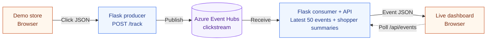
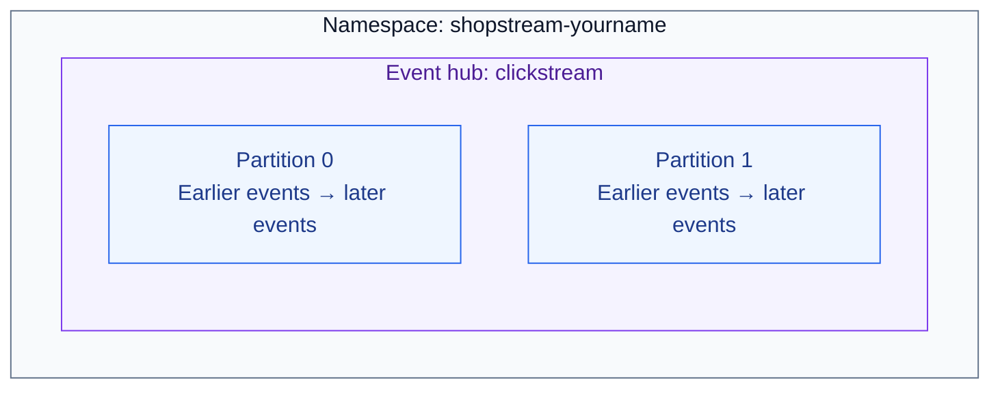
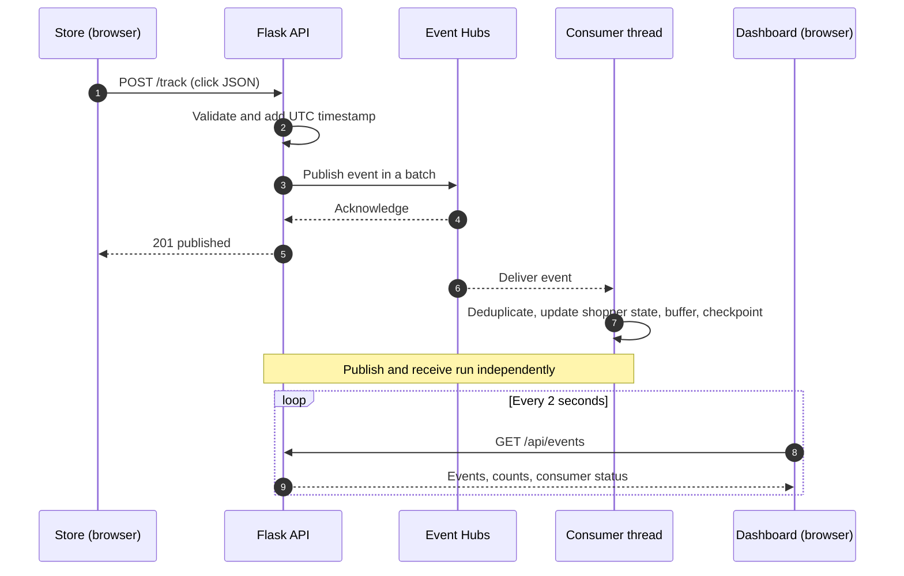

# Week 10 Lab: Clickstream Analytics with Azure Event Hubs

**CST8916 — Remote Data and Real-time Applications**

When someone browses an online store, each page view, product click, or cart action tells a small part of their story. A sequence of these actions is called a **clickstream**. Each action can be represented as an **event**: a JSON message describing what happened and when.

In this lab, you will use **Azure Event Hubs** to carry those events from a demo store to a live dashboard. Event Hubs stores a stream of events so an application can publish them now and another application can read and process them at its own pace.

You will first run the application on your computer, then deploy the same code to **Azure App Service**. No previous Event Hubs experience is required.

By the end, you should be able to:

- Identify the producer and consumer in an event streaming application.
- Explain namespaces, event hubs, partitions, and consumer groups.
- Trace a browser action through Azure to the dashboard.
- Explain how retention, checkpoints, and an in-memory buffer affect replay.

## Lab roadmap

1. [Understand the application](#1-understand-the-application)
2. [Prepare your environment](#2-prepare-your-environment)
3. [Create the Event Hubs resources](#3-create-the-event-hubs-resources)
4. [Run and explore locally](#4-run-and-explore-locally)
5. [Trace an event through the code](#5-trace-an-event-through-the-code)
6. [Deploy to Azure App Service](#6-deploy-to-azure-app-service)
7. [Verify the event stream](#7-verify-the-event-stream)
8. [Reflect on the design](#8-reflect-on-the-design)
9. [Clean up Azure resources](#9-clean-up-azure-resources)

## 1. Understand the application

**ShopStream** has three browser views served by one Flask application:

| Page | Path | What you will see |
| --- | --- | --- |
| Demo store | `/` | Product details, a cart drawer, quantity controls, and expandable event activity |
| Checkout | `/checkout` | Order review, simulated purchase, and order confirmation |
| Live dashboard | `/dashboard` | Recent events, shopper filtering, cart state, high-value checkouts, and consumer status |

The Flask application has two Event Hubs roles. The **producer** publishes browser events through `/track`. The **consumer** runs on a background thread, reads events from Azure, and updates recent-event buffers and shopper summaries. The dashboard requests that state through `/api/events` every two seconds. Publishing never updates the dashboard directly.

### Application architecture



The browser communicates with Flask; the Azure connection string stays on the server. A successful publish means Azure accepted an event. The event appears on the dashboard only after the consumer receives it.

### Why introduce Event Hubs?

For a small demo, a list or database can store clicks directly. Event Hubs introduces useful capabilities as an application grows:

- **Independent processing:** Analytics, fraud detection, and other applications can read the same stream using separate consumer groups.
- **Retention and replay:** A consumer can read retained events after an interruption or process them again.
- **Parallel processing:** Partitions let applications distribute work across readers. Available namespace capacity and application design still limit throughput.

Event Hubs retains events for the configured period even after they are read. It does not calculate the dashboard's counts; our Python code does that. See [Microsoft's Event Hubs concepts](https://learn.microsoft.com/en-us/azure/event-hubs/event-hubs-features).

### Terms you will use

| Term | Meaning in this lab |
| --- | --- |
| **Namespace** | The Azure resource containing your event hub and its connection endpoint |
| **Event hub** | The named stream, `clickstream`, that stores the events |
| **Partition** | An ordered sequence within that stream; this lab uses two |
| **Producer** | The Flask code using `EventHubProducerClient` to send events |
| **Consumer** | The background thread using `EventHubConsumerClient` to read events |
| **Consumer group** | An independent view of a stream; this app uses the built-in `$Default` group |
| **Checkpoint** | A record of a consumer's progress within a partition |

## 2. Prepare your environment

You need:

- Python **3.12 recommended** (3.11 or later) and pip.
- Git, a GitHub account, and a code editor.
- An Azure subscription that allows you to create Event Hubs and Linux App Service resources.
- Access to the [Azure portal](https://portal.azure.com).

**Costs:** Event Hubs Basic is a paid tier. Use the subscription and pricing plan approved for your course, and complete the cleanup step. Azure CLI is optional; the main exercise uses the portal.

### Fork and clone once

1. Open the instructor's lab repository on GitHub and select **Fork**.
2. Clone your fork, replacing `YOUR-USERNAME` with your GitHub username:

```bash
git clone https://github.com/YOUR-USERNAME/26F_CST8916_Week10-Event-Hubs-Lab.git
cd 26F_CST8916_Week10-Event-Hubs-Lab
```

Use this same clone for the local exercise and deployment.

### Create a virtual environment

A virtual environment keeps this lab's Python packages separate from other projects.

**Linux / macOS:**

```bash
python3 -m venv .venv
source .venv/bin/activate
python -m pip install -r requirements.txt
```

**Windows PowerShell:**

```powershell
py -3 -m venv .venv
.\.venv\Scripts\Activate.ps1
python -m pip install -r requirements.txt
```

The remaining Python commands assume the virtual environment is active. If you open a new terminal, activate it again.

## 3. Create the Event Hubs resources

### 3.1 Create a resource group and namespace

1. In the Azure portal, search for **Resource groups** and select **Create**.
2. Choose your subscription, name the group `cst8916-week10-rg`, and select **Canada Central** or your instructor's region.
3. Select **Review + create**, then **Create**.
4. Search for **Event Hubs** and select **Create**.
5. Use these settings:

| Setting | Value |
| --- | --- |
| Resource group | `cst8916-week10-rg` |
| Namespace name | `shopstream-yourname` (replace `yourname`; must be globally unique) |
| Region | Same region as your resource group |
| Pricing tier | **Basic** |
| Throughput units, if shown | **1** |

6. Select **Review + create**, then **Create**. When deployment finishes, select **Go to resource**.

### 3.2 Create the event hub

Inside the namespace, select **+ Event Hub** (or **Entities → Event Hubs → + Event Hub**) and create:

| Setting | Value |
| --- | --- |
| Name | `clickstream` |
| Partition count | **2** |
| Message retention | **1 day** (24 hours) |

Your resource structure will look like this. The boxes show containment; each partition stores its own ordered sequence.



Ordering is guaranteed **within a partition**, so events read from different partitions do not form one guaranteed global order. Two partitions allow parallel reading; they do not automatically double throughput.

Basic supports one consumer group and up to one day of retention, which is sufficient for this exercise. Adding independent consumer groups requires a higher tier. See the [Event Hubs tier comparison](https://learn.microsoft.com/en-us/azure/event-hubs/compare-tiers).

### 3.3 Create a connection policy

This app both publishes and receives, so its connection string needs **Send** and **Listen** permissions.

1. Open the namespace's **Shared access policies** page.
2. Select **+ Add**, name the policy `clickstream-lab`, and select **Send** and **Listen**. Leave **Manage** unchecked.
3. Save the policy, open it, and copy the **Connection string–primary key** value. Copy the connection string, not just the key.

Keep this value private. Store it in environment variables, and exclude it from commits, screenshots, and submitted work. The lab policy gives the app the permissions it needs without using the namespace's administrative `RootManageSharedAccessKey`. See [Microsoft's shared access policy guidance](https://learn.microsoft.com/en-us/azure/event-hubs/authorize-access-shared-access-signature).

## 4. Run and explore locally

### 4.1 Set the environment variables

In your activated terminal, replace the placeholder with the **entire connection string** copied from Azure.

**Linux / macOS:**

```bash
export EVENT_HUB_CONNECTION_STR='PASTE-YOUR-CONNECTION-STRING-HERE'
export EVENT_HUB_NAME='clickstream'
```

**Windows PowerShell:**

```powershell
$env:EVENT_HUB_CONNECTION_STR = 'PASTE-YOUR-CONNECTION-STRING-HERE'
$env:EVENT_HUB_NAME = 'clickstream'
```

These settings apply to the current terminal session. The app reads them with `os.environ.get()`; it does not load a `.env` file automatically.

### 4.2 Start Flask

```bash
python app.py
```

Keep the terminal open. Flask listens on port **8000**, and the consumer starts in the background. Missing settings stop startup; authentication and network failures may appear later when the SDK connects.

### 4.3 Follow one click

1. Open the store at [http://localhost:8000](http://localhost:8000).
2. Open the dashboard at [http://localhost:8000/dashboard](http://localhost:8000/dashboard) in a second tab or window.
3. In the store, open a product's details, select **Add to cart**, and select **Find your next favourite** in the banner.
4. Expand **Event activity** near the bottom of the store. Check that its publish log confirms **published to Event Hubs**.
5. Watch the dashboard for those events after the consumer receives them. The display refreshes every two seconds; allow extra time for the initial connection.

| Action | Event type |
| --- | --- |
| Load the store or navigate between shopping and checkout | `page_view` |
| Open product details | `product_click` |
| Select **Add to cart** | `add_to_cart` |
| Open the cart drawer | `view_cart` |
| Change an item's quantity | `cart_update` |
| Remove an item, including decreasing its quantity to zero | `remove_from_cart` |
| Enter checkout review | `begin_checkout` |
| Return from checkout to shopping | `checkout_exit` |
| Select **Find your next favourite** | `banner_click` |
| Select **Place demo order** and confirm publishing | `purchase` |

### 4.4 Follow a high-value shopper

1. Add **UltraBook Pro ($999)** and **NoiseFree Buds ($129)**. Open **Cart**, try its quantity controls, and verify the subtotal is **CAD $1,128** with one of each item.
2. Select **Review & check out**. The review page shows the items and total. Payment, shipping, and tax are omitted; this is a simulated order.
3. On the dashboard, find the shopper ID shown near the bottom of the store. Select that shopper using the table or **Filter by shopper**. Inspect their current cart, activity timeline, and filtered recent-event metrics.
4. The shopper appears under **High-value shoppers at checkout**: their current cart is **strictly greater than CAD $1,000**, their stage is checkout, and a tracked action occurred less than five minutes ago.
5. Return to shopping to see the flag clear, then enter checkout again. Select **Place demo order**. Once Event Hubs confirms publishing, the store shows the order confirmation and clears the cart. Once the consumer receives the event, the dashboard removes the flag and updates observed orders and spending.
6. Open the store in a different browser or private window to create another shopper. Verify that their carts and activity stay separate. A private window usually shares an identity with other windows in the same private-browsing session.

Each browser keeps its anonymous user ID, cart, and event sequence in `localStorage`. Its session ID uses `sessionStorage`, so refreshing preserves it. Use **one store tab per browser** and a separate dashboard tab. The short ID on the store matches the dashboard; the full ID is available on hover or in the shopper detail panel. Clearing browser storage creates a new shopper and removes that browser's cart.

Activity means a tracked interaction, not an open tab or heartbeat. Waiting five minutes clears active status and the checkout flag on the next dashboard refresh. Replaying old events does not make shoppers active again because freshness uses the original event timestamp.

If purchase publishing cannot be confirmed, the cart and pending order stay saved. **Retry demo order** reuses the same event and order IDs, including after refreshing. Cart editing is held until that pending order is confirmed; the consumer deduplicates deliveries so a retry does not add spending twice.

**Checkpoint:** Before continuing, confirm both a successful publish in the store and a received event on the dashboard. They verify different parts of the path.

## 5. Trace an event through the code

### Project map

```text
26F_CST8916_Week10-Event-Hubs-Lab/
├── app.py                    # Flask routes, Event Hubs producer, background consumer
├── shop.py                   # Catalogue, cent-based pricing, consumer-side shopper state
├── requirements.txt          # Python packages
├── README.md                 # Lab instructions
├── .gitignore                # Excludes local environments and secret files
├── static/                   # Store/dashboard JS and CSS; local SVG product illustrations
└── templates/
    ├── client.html           # Store, cart drawer, and checkout views
    └── dashboard.html        # Dashboard structure
```

Start with `track()` and `send_to_event_hubs()` in [app.py](app.py), then follow `_receive_events()`, `_on_event()`, and `get_events()`.

### Event journey



The sequence shows one possible timing. The consumer may receive an event before the store gets its HTTP response. The dashboard polls a Flask route; it does not connect directly to Event Hubs.

### Functions to focus on

| Function in `app.py` | What to notice |
| --- | --- |
| `track()` | Calls `normalize_event()` to validate the request, calculate prices, and add a UTC timestamp |
| `send_to_event_hubs()` | Serializes the event, wraps it in `EventData`, and sends a batch using the shopper ID as its partition key |
| `start_consumer()` | Creates the `$Default` consumer and starts its background thread |
| `_receive_events()` | Calls the blocking SDK `receive()` method without blocking Flask's request handling |
| `_on_event()` | Parses received JSON, calls the shopper projection, and checkpoints progress |
| `get_events()` | Returns a consistent snapshot of recent events, their counts, shopper summaries, and consumer status |

In `shop.py`, `normalize_cart()` validates quantities and calculates integer-cent amounts from the server catalogue. `ShopperAnalytics.consume()` deduplicates events, records completed orders once, and applies newer cart snapshots. `snapshot()` computes activity and high-value flags at request time. The buffer lock protects data shared by Flask and the consumer thread. The producer uses a client per request to keep this small example easy to follow; higher-volume applications can reuse appropriately managed clients.

### Example event

```json
{
  "schema_version": 1,
  "event_id": "e_example",
  "sequence": 3,
  "event_type": "add_to_cart",
  "page": "/",
  "product_id": "p_shoe_01",
  "user_id": "u_4a2f",
  "session_id": "s_9b3e",
  "stage": "shopping",
  "cart_items": [
    {
      "product_id": "p_shoe_01",
      "name": "Trail Runners",
      "quantity": 1,
      "unit_price_cents": 8999,
      "line_total_cents": 8999
    }
  ],
  "cart_total_cents": 8999,
  "item_count": 1,
  "currency": "CAD",
  "timestamp": "2026-11-13T14:22:05.123456+00:00"
}
```

The browser sends product IDs and quantities in `cart_items`. Flask supplies product names, integer-cent prices, totals, and `timestamp`; client-provided prices are ignored. Version 1 requires stable event/user/session IDs, a positive increasing `sequence`, a `stage` (`shopping`, `checkout`, or `purchased`), and a full cart snapshot. Quantities are integers from 1 to 99; duplicate or unknown product IDs are rejected. Checkout and purchase require a nonempty cart, and purchases require an `order_id`.

The original unversioned event format is still accepted for the original event types. Those messages appear in feeds and recent counts but do not infer cart values or observed spending. Every new event carries a full snapshot, so missing earlier cart actions do not require reconstructing the cart from deltas. A purchase's snapshot describes its purchased items; consuming it records the order and clears the current cart. The browser serializes publishing requests, and the shopper partition key groups that browser's events in one partition. Increasing browser sequences prevent late older snapshots from replacing newer state.

### API reference

| Method and path | Purpose |
| --- | --- |
| `GET /` | Serve the store |
| `GET /checkout` | Serve order review or the latest local order confirmation |
| `GET /dashboard` | Serve the dashboard |
| `GET /api/catalog` | Return the six server-priced products and CAD currency |
| `POST /track` | Publish an event; return `201` when confirmed, `400` for invalid input, or `503` when publishing cannot be confirmed |
| `GET /api/events?limit=50` | Return recent events, counts, consumer status, shopper summaries, active shoppers, and high-value checkout count; default limit 20, clamped to 1–50; invalid integers use 20 |
| `GET /api/events?limit=50&user_id=u_4a2f` | Filter the event window and counts to that shopper's separate history; include `selected_shopper`; the shopper roster and active/flagged counts remain global |
| `GET /health` | Report consumer status; return `503` for a reported error or stopped consumer |

`/health` returns `200` while waiting for events, which does **not** prove the consumer has connected successfully. The dashboard's **EVENTS RECEIVED** state records a past successful receive; check its last receive time when investigating stale data.

### Retention, replay, and the dashboard window

These are different kinds of state:

- **Azure retention:** Event Hubs keeps events for one day, independently of whether the app has read them.
- **Consumer progress:** `starting_position="-1"` starts at the earliest retained event. Checkpoints are held in this client's memory because no persistent checkpoint store is configured.
- **Dashboard windows:** The app keeps the latest 50 unique events globally and the latest 50 per shopper **in receive order**. Recent-event KPIs and the type chart describe the selected window, not lifetime activity. Selecting a shopper continues to work after their events leave the global window.
- **Shopper projection:** Current carts, stages, observed order counts/spending, and deduplication IDs live in process memory independently of the windows. Active status and flags are recalculated on every poll using original timestamps. These summaries are small demo state, not a durable order database.
- **Browser cart:** `localStorage` retains the shopper ID, cart, and pending/last order in that browser. This is separate from the consumer's view of received events.

Restarting the app clears the buffers, shopper summaries, deduplication sets, and checkpoints, then replays retained events to rebuild them. Earlier clicks may reappear. Event IDs prevent repeated deliveries from entering a window twice within a run, and order IDs prevent repeated purchases from adding spending twice. Legacy events use partition/sequence metadata for redelivery detection. **Observed spend** covers the events processed during the run, including retained replay; activity older than retention cannot be rebuilt. Keep the catalogue prices fixed during the exercise, since received snapshots are revalidated against it. A persistent checkpoint store enables progress to survive restarts; durable projections would be needed alongside it. See the [Python consumer SDK reference](https://learn.microsoft.com/en-us/python/api/azure-eventhub/azure.eventhub.eventhubconsumerclient?view=azure-python).

## 6. Deploy to Azure App Service

### 6.1 Prepare your fork's workflow

Your fork needs its own Azure-generated workflow. This checkout does not include a deployment workflow. If your fork inherited an instructor workflow targeting `Clickstream` or another app, remove that file before configuring Deployment Center. Leave GitHub Actions disabled until you connect your own App Service below.

### 6.2 Create the web app

In the Azure portal, search for **App Services**, select **Create → Web App**, and use:

| Setting | Value |
| --- | --- |
| Resource group | `cst8916-week10-rg` |
| Name | `shopstream-web-yourname` (must be available) |
| Publish | **Code** |
| Runtime stack | **Python 3.12** |
| Operating system | **Linux** |
| Region | Same region as the namespace, where available |
| App Service plan | **Free F1**, if available for your subscription and region |

If F1 is unavailable, consult your instructor before choosing a paid plan. Create the app, then open its resource page.

### 6.3 Add the app settings

Open **Settings → Environment variables → App settings** and add:

| Name | Value |
| --- | --- |
| `EVENT_HUB_CONNECTION_STR` | The full connection string from section 3.3 |
| `EVENT_HUB_NAME` | `clickstream` |
| `SCM_DO_BUILD_DURING_DEPLOYMENT` | `true` (enables dependency installation during deployment) |

Apply the changes. Keep the **Startup command blank**: App Service detects the root `app.py` and loads its Flask object with Gunicorn as `app:app`. The consumer starts when the module loads. See [Microsoft's Flask startup documentation](https://learn.microsoft.com/en-us/azure/app-service/configure-language-python#flask-app).

Use **one Gunicorn worker and one App Service instance** for this lab. Each process has its own buffer; scaling this design requires shared storage and coordinated consumers. Free-tier apps can also unload when idle, so keep the dashboard open during the demonstration. See [App Service configuration](https://learn.microsoft.com/en-us/azure/app-service/configure-common#configure-general-settings).

### 6.4 Connect GitHub deployment

1. In App Service, open **Deployment Center**.
2. Select **GitHub** as the source and authorize access when prompted.
3. Select your GitHub account, your fork, and the `main` branch.
4. Review the workflow preview and confirm it targets **your** app and Python version. Use the portal's recommended identity-based authentication when your subscription allows it.
5. Save. Azure generates a workflow in your fork. If GitHub shows that Actions are disabled, enable them and run the generated workflow.
6. Open GitHub's **Actions** tab and wait for the deployment to succeed.

Azure deployment setup needs permission to configure deployment credentials or identities. If your course subscription restricts this, ask your instructor to provide the approved connection. See [Microsoft's GitHub Actions deployment guide](https://learn.microsoft.com/en-us/azure/app-service/deploy-github-actions).

### 6.5 Verify and redeploy

1. Stop the local server with **Ctrl+C** so you are demonstrating the Azure-hosted app.
2. In App Service **Overview**, open the **Default domain**. Use the exact address Azure provides.
3. Generate a few clicks, then open `/dashboard` on that domain.
4. Verify both the store's publish log and the dashboard's last receive time. A green deployment confirms code deployment; received events confirm the Azure event path.

To demonstrate continuous deployment:

```bash
git pull --ff-only
```

This brings in the workflow changes made on GitHub. Edit the welcome banner's `<h1>` text in `templates/client.html`, then run:

```bash
git add templates/client.html
git commit -m "Update store welcome banner"
git push
```

Watch the new Actions run, then refresh the deployed store to see the change.

## 7. Verify the event stream

### Compare the app with Azure metrics

1. Open your Event Hubs namespace in the Azure portal and select **Monitoring → Metrics**.
2. Add **Incoming Messages** and **Outgoing Messages**, using **Sum** and a recent time range.
3. Generate several store events and allow time for metrics to refresh.
4. Compare the activity with the store's publish log and dashboard feed.

Incoming Messages counts events sent to Event Hubs; Outgoing Messages counts events read from it. Replays and additional readers can make these counts differ. Metrics show volume, while the dashboard shows this app's received JSON events. See the [Event Hubs metrics reference](https://learn.microsoft.com/en-us/azure/event-hubs/monitor-event-hubs-reference).

## 8. Reflect on the design

Discuss these before opening the suggested answers:

1. Which code is the producer? Which code is the consumer? What does the dashboard read?
2. What ordering guarantee do two partitions provide? Why might throughput stay the same after adding partitions?
3. What happens to the dashboard and consumer progress when you restart this app?
4. If the consumer is offline for two days, which events can it read when it returns?
5. What would need to change before running several App Service instances?
6. Why does the app's policy need both Send and Listen, but not Manage?
7. Why does a cart above $1,000 not always count as a high-value checkout? Why should replay not make an old shopper active?
8. Why keep shopper summaries separately from the latest 50 events? Why are both event IDs and order IDs useful?

<details>
<summary>Suggested answers</summary>

1. `track()` and `send_to_event_hubs()` produce events. The background `EventHubConsumerClient` receives them through `_on_event()`. The dashboard reads the Flask buffer through `/api/events`.
2. Each partition preserves its own order; there is no guaranteed order across partitions. Partitions enable parallelism, while namespace capacity, event distribution, and processing speed still limit throughput.
3. The buffer and in-memory checkpoints disappear. The app rereads retained events because it starts at `"-1"`; previously displayed events can return.
4. Only events still within the one-day retention period remain available. Reading an event does not extend its retention.
5. Use shared storage for dashboard data and a persistent checkpoint store to coordinate consumer progress and partition ownership. Plan for redelivery and manage producer connections for higher load.
6. Send permits publishing and Listen permits receiving. Manage grants administrative capabilities that this app does not need. The connection string belongs in the server environment, outside source control.
7. A high-value checkout also requires the checkout stage and a tracked action in the last five minutes. The original event timestamp measures freshness; receiving an old event now does not mean the shopper is currently shopping.
8. A recent window can evict events without changing a shopper's current cart or completed spending. Event IDs deduplicate deliveries and retries; order IDs also prevent another event for the same order from increasing spending again. State remains process-local and must be rebuilt on restart.

</details>

## 9. Clean up Azure resources

After the exercise, delete the dedicated lab resource group to remove its Event Hubs namespace, web app, and App Service plan.

1. In the Azure portal, open **Resource groups → cst8916-week10-rg**.
2. Check that it contains only resources you created for this lab.
3. Select **Delete resource group** and confirm its name.

If you already use Azure CLI, the equivalent command is:

```bash
az group delete --name cst8916-week10-rg
```

Deleting the resource group permanently removes its resources. Stopping the web app alone does not remove the Event Hubs namespace or a paid App Service plan.
